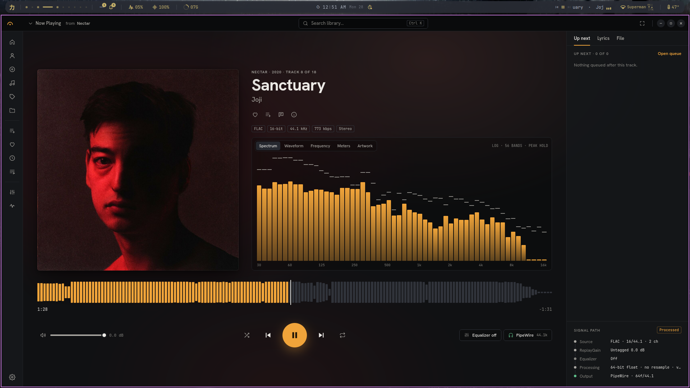
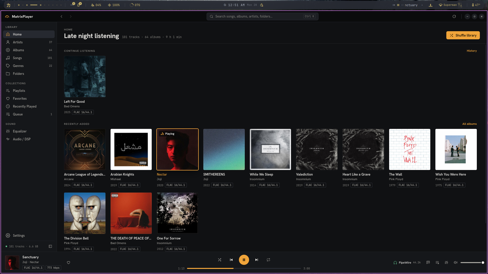
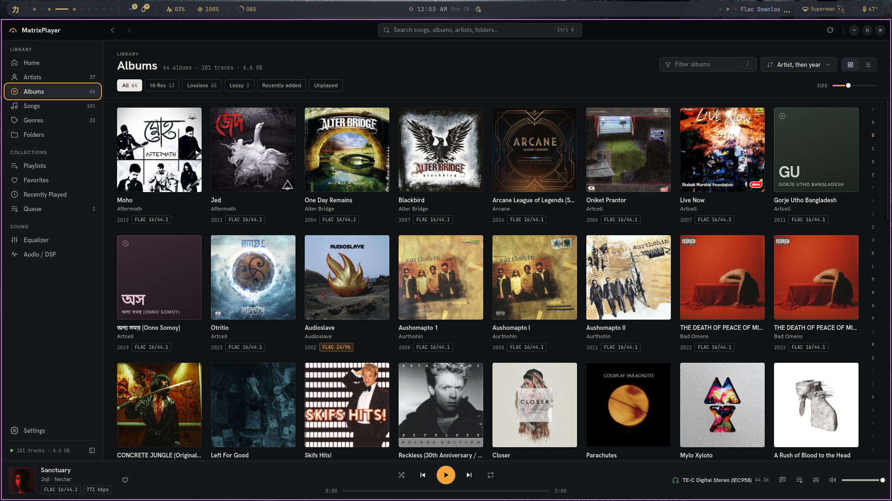
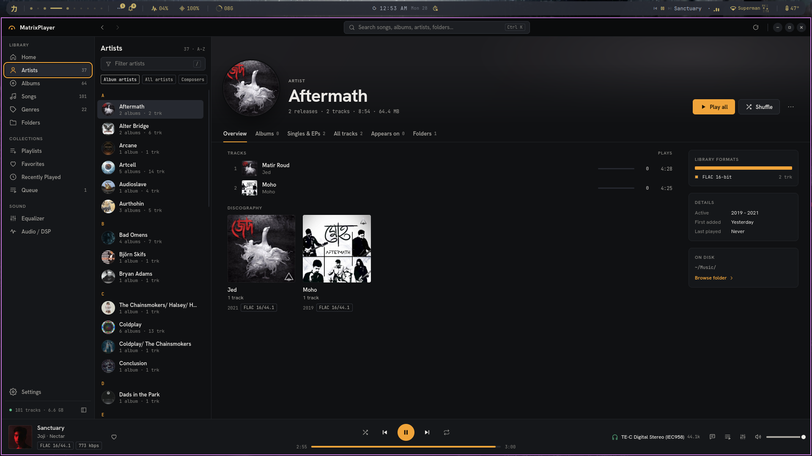
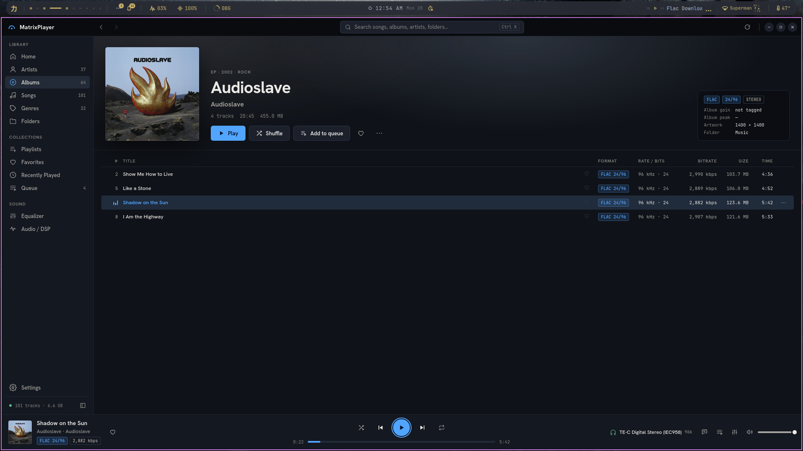
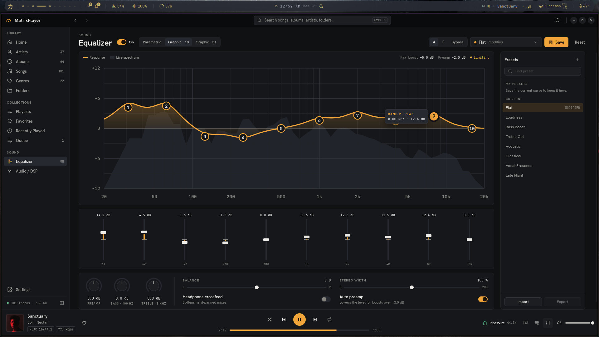
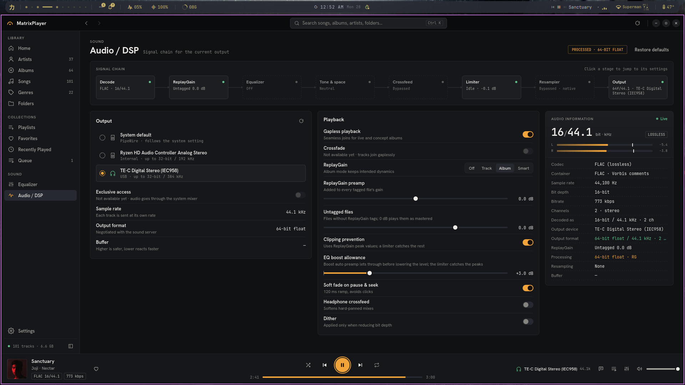
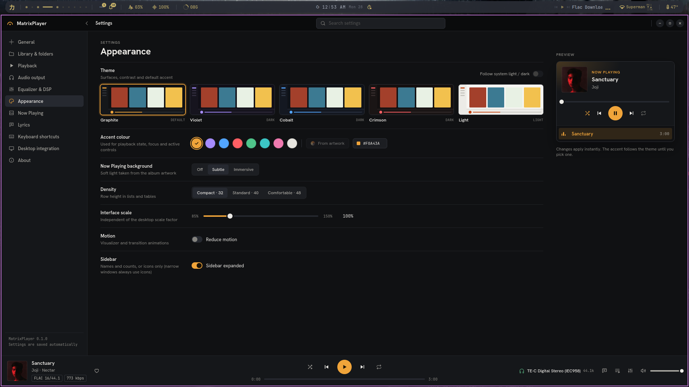

<div align="center">


# MatrixPlayer

**An audio-focused music player for Linux, in the spirit of Poweramp.**

Native playback on GStreamer and PipeWire with a 64-bit float DSP chain,
a fast local library, and a desktop app built with Tauri 2 and React.


[**Download**](https://github.com/Matr1x01/MatrixPlayer/releases/latest) ·
[Features](#features) ·
[Screenshots](#screenshots) ·
[Build from source](#build-from-source)



</div>

## Install

Grab a package from the [latest release](https://github.com/Matr1x01/MatrixPlayer/releases/latest)
(x86_64):

| Package | For | Install |
| --- | --- | --- |
| `MatrixPlayer_0.1.0_amd64.AppImage` | Any distribution, including Arch | `chmod +x MatrixPlayer_0.1.0_amd64.AppImage && ./MatrixPlayer_0.1.0_amd64.AppImage` |
| `MatrixPlayer_0.1.0_amd64.deb` | Debian, Ubuntu, Mint, Pop!_OS | `sudo apt install ./MatrixPlayer_0.1.0_amd64.deb` |
| `MatrixPlayer-0.1.0-1.x86_64.rpm` | Fedora, openSUSE | `sudo dnf install ./MatrixPlayer-0.1.0-1.x86_64.rpm` |

The AppImage ships its own GStreamer. The `.deb` and `.rpm` packages use the
system's GStreamer and pull in the base, good and PipeWire plugins. For AAC
and ALAC (`.m4a`), also install `gstreamer1.0-libav` (Debian/Ubuntu) or
`gstreamer1-libav` (Fedora).

The `.deb` and `.rpm` packages add a desktop entry that registers MatrixPlayer
for audio files, with Play/Pause, Next and Previous actions in your launcher.

## Features

### Sound

- **Native pipeline.** GStreamer `playbin3` into PipeWire, with PulseAudio and
  ALSA as fallbacks. Every stage runs in 64-bit float.
- **Gapless playback**, plus a short soft fade on pause and seek so there are
  no clicks.
- **ReplayGain** in track, album or *smart* mode (album normally, track while
  shuffling). It prevents clipping using the stored peak values, with separate
  preamps for tagged and untagged files.
- **Equalizer** with parametric, 10-band graphic and 31-band graphic modes. The
  response curve is drawn over the live spectrum. It comes with 8 built-in
  presets, lets you save your own and import or export them, and has A/B
  compare and bypass.
- **Tone and space controls:** preamp, auto preamp with an adjustable boost
  allowance, bass and treble shelves, balance, stereo width, headphone
  crossfeed and a peak limiter.
- **Signal path view.** It shows every stage from decode to output (source
  format, ReplayGain, EQ, processing and the negotiated output format). Click
  a stage to jump to its settings.
- **Output devices.** Switch between PipeWire devices mid-track without losing
  your place. If PipeWire restarts (after an update, say), playback reconnects
  and carries on.

### Library

- Add your music folders. Scans are incremental, the folders are watched for
  changes, and renamed files are recognized.
- Browse by **albums, artists** (album artists, all artists or composers),
  **songs, genres and folders**.
- Filter albums by Hi-Res, Lossless, Lossy, Recently added or Unplayed. Sort
  them, switch between grid and list, and jump by letter.
- **Instant search** (`Ctrl K`) across songs, albums, artists and folders,
  with accent folding, so "Bjork" finds "Björk".
- Format badges throughout (for example `FLAC 24/96`) and a file info dialog
  for every track.
- Artwork read from your files, cached and thumbnailed.
- A home page with *Continue listening*, *Recently added* and *Most played*.

### Queue and playlists

- A reorderable queue. *Play next* keeps your picks in the order you chose
  them, and you can undo when the queue is replaced or cleared.
- Shuffle, and repeat (off, all, one).
- Playlists that you can pin, rename and reorder. MatrixPlayer asks before
  adding tracks a playlist already has.
- Favorites and *Recently played*.
- **Session restore:** MatrixPlayer reopens where you left off.
- Missing or unreadable files are reported and skipped, and the next track
  still plays.

### Now Playing

- Large artwork with an ambient backdrop taken from the album art (off,
  subtle or immersive).
- Visualizers: spectrum, waveform, frequency and level meters.
- A **waveform seek bar** drawn from the track itself.
- **Synced lyrics** from a sidecar `.lrc` file or from embedded tags, with
  offsets and word timings.
- A side panel with *Up next*, *Lyrics* and *File* tabs.

### Linux desktop

- **MPRIS 2:** media keys, desktop and bar media controls, lock screens.
- Track change notifications.
- A single instance. Opening files from your file manager, dropping them onto
  the window, or passing them on the command line all go to the running
  player.
- [Command-line controls](#command-line) for scripts and keybindings.

### Look and feel

- Five themes: Graphite, Violet, Cobalt, Crimson and Light.
- Eight accent colours.
- Row density (compact, standard, comfortable), interface scale from 85% to
  150%, a collapsible sidebar, and *Reduce motion* (the system's
  `prefers-reduced-motion` setting is also respected).
- Full keyboard control and searchable settings.

## Screenshots

| | |
| --- | --- |
|  **Home.** Continue listening and recently added albums |  **Albums.** Filters, sorting and format badges |
|  **Artists.** Discography, formats and details |  **Album.** 24/96 FLAC, shown in the Cobalt theme |
|  **Equalizer.** 10-band graphic EQ over the live spectrum |  **Audio / DSP.** Signal chain, output devices and ReplayGain |
|  **Now Playing.** Visualizer, waveform seek and signal path |  **Settings.** Themes, accents, density and scale |

## Keyboard shortcuts

| Action | Keys |
| --- | --- |
| Play / pause | `Space` |
| Next / previous track | `Ctrl →` / `Ctrl ←` |
| Seek forward / back 10 s | `Shift →` / `Shift ←` |
| Volume up / down | `Ctrl ↑` / `Ctrl ↓` |
| Mute · Shuffle · Repeat | `M` · `S` · `R` |
| Search the library | `Ctrl K` or `Ctrl F` |
| Filter the current list | `/` |
| Favorite the playing track | `L` |
| New playlist | `Ctrl N` |
| In lists: play · play next · add to queue | `Enter` · `Shift Enter` · `Q` |
| In lists: open album · open artist · file info | `Alt A` · `Alt R` · `Ctrl I` |
| Open files · open folder | `Ctrl O` · `Ctrl Shift O` |
| Now Playing · Settings | `Ctrl P` · `Ctrl ,` |
| Back / forward | `Alt ←` / `Alt →` |
| Full screen | `F11` |

Media keys work everywhere through MPRIS. The same list is under
*Settings → Keyboard shortcuts*.

## Command line

```sh
matrixplayer ~/Music/Album            # play a folder
matrixplayer song.flac other.opus     # play files (paths or file:// URIs)
matrixplayer --play-pause             # also --play, --pause, --stop, --next, --previous
```

When MatrixPlayer is already running, these go to the open window instead of
starting a second copy, so you can bind them to keys in your compositor.

| Variable | Effect |
| --- | --- |
| `MATRIXPLAYER_AUDIO_SINK=pipewire\|pulse\|alsa\|auto\|null` | Force an output backend. `null` plays in real time into nothing, for headless runs. |
| `RUST_LOG=matrixplayer_lib=debug` | Log pipeline decisions (gapless queueing, errors). |

## Troubleshooting

MatrixPlayer writes a log for each launch to
`~/.local/share/io.github.matr1x01.MatrixPlayer/logs/`; `latest.log` is the
newest. *Settings → About* opens the folder and sets how long logs are kept
(7 days by default, never more than 64 MB in all). Each log records:

- the version, how MatrixPlayer was started, the distribution and kernel, and
  the environment variables that affect GStreamer, PipeWire and WebKit (an
  AppImage sets several);
- the GStreamer version, where each plugin playback needs was loaded from,
  which formats it can decode, and any plugin that failed to load;
- errors and warnings from MatrixPlayer, GStreamer and the interface, and
  anything the libraries underneath print to the terminal;
- crashes, with where they happened.

What to look for:

- **Nothing happens when you launch it.** Look for *MatrixPlayer is already
  running (pid …)*. A launch hands over to the copy that is already running,
  even one that has stopped responding. End that process (`kill <pid>`) and
  launch again.
- **The window stays blank.** If there is no *interface started* line, the web
  view did not load: look at the `stderr` lines from WebKit and EGL.
- **No sound after a system update.** Look for *PipeWire went away*: an
  update that restarts PipeWire is followed by *reconnected the audio output*,
  or by why it could not. Look also for *GStreamer could not load … plugins*,
  and at the `plugin` lines near the top.
- **It closed by itself.** The next launch logs *the previous run did not exit
  normally* and names that run's log.

If the AppImage does not start at all, run it from a terminal: a library that
fails to load stops it before it can write a log.

## Not yet

These features show in the interface as unavailable instead of pretending to
work:

- Crossfade (tracks join gaplessly instead)
- Exclusive device access, and forcing an output sample rate or bit depth
- Per-device EQ presets
- Accent colour taken from artwork, and following the system's light or dark
  setting
- A Flatpak package

## Build from source

### Requirements

- Rust 1.92+ and Node 20+
- GStreamer 1.22+ with the base and good plugins (FLAC, WAV, Vorbis, Opus),
  `gst-libav` or `gst-plugins-bad` for AAC and ALAC, and the PipeWire
  GStreamer plugin
- WebKitGTK 4.1 and the other [Tauri Linux prerequisites](https://tauri.app/start/prerequisites/)
- A D-Bus session bus for MPRIS and notifications (optional; both are skipped
  without one)

On Arch Linux, the audio part is:

```sh
sudo pacman -S --needed gstreamer gst-plugins-base gst-plugins-good gst-plugin-pipewire gst-libav webkit2gtk-4.1
```

### Commands

```sh
npm install
npm run tauri dev                   # run the app
npm run tauri dev -- -- ~/Music     # …and play a folder or files from the command line
npm run check                       # type-check, frontend tests, Rust tests
cargo test --manifest-path src-tauri/Cargo.toml -- --ignored   # + tests against a real sound server
npx tauri build                     # release build and packages (.deb, .rpm, AppImage)
```

Packages are written to `src-tauri/target/release/bundle/`. An AppImage built
this way runs only on systems with this one's glibc or newer, so one built on
a rolling distribution such as Arch will not start on Ubuntu. To build one
that does, in an Ubuntu container (needs Docker):

```sh
scripts/build-appimage.sh           # on Ubuntu 22.04: runs on glibc 2.35+
scripts/build-appimage.sh 24.04     # on Ubuntu 24.04: runs on glibc 2.39+
```

The AppImage lands in `dist-appimage/ubuntu-<release>/` and carries that
release's GStreamer, with only the plugins listed in
`packaging/appimage/plugins.txt`.

The desktop entry
(`src-tauri/linux/matrixplayer.desktop`) registers the audio MIME types and
launcher actions. AppStream metadata is in
`src-tauri/linux/io.github.matr1x01.MatrixPlayer.metainfo.xml`.

### UI harness

`npm run dev`, then open
`http://localhost:5173/dev/harness.html?view=equalizer` to render any view in
a normal browser against mocked IPC and sample data. It accepts the `view`,
`id`, `tab`, `theme`, `accent`, `empty`, `noroots`, `scanning`, `search` and
`menu` query parameters. The harness feeds a synthetic analysis stream so the
visualizers move.

## Architecture

```text
React UI (src/)               renders state, sends commands; never holds playback state
   │  commands ▲ events
Tauri glue (src-tauri/src/commands, events.rs)          MPRIS / notifications (desktop/)
   │                                                        │ same commands, same events
Services: player/ · library/ · dsp/service.rs ◀─────────────┘
   │
Audio engine (audio/, dsp/)   GStreamer playbin3 ─ F64 DSP chain ─ volume ─ output sink
   │
PipeWire  (PulseAudio / ALSA fallbacks)
```

Rust (`src-tauri/src`):

| Module | Responsibility |
| --- | --- |
| `audio/` | `AudioEngine`: one `playbin3` for the app's lifetime. Gapless via `about-to-finish`; bus messages are tagged with a pipeline *epoch* at post time so events from a replaced stream are dropped. Output backends and devices (listed through the backend's GStreamer device provider), negotiated formats, and waveform overviews decoded off the playback path and cached. |
| `dsp/` | The `audio-filter` chain, in 64-bit float: ReplayGain from in-stream tags (exact at gapless joins) with peak-based clipping prevention, preamp and auto preamp, parametric and graphic EQ (RBJ biquads), bass/treble shelves, balance, stereo width, crossfeed, soft fades, a peak limiter, and an analysis tap (FFT spectrum, scope, peak/RMS) aligned with what is audible. `service.rs` persists settings and presets. |
| `player/` | `Queue` (play order, shuffle, repeat, reordering) and the player service actor. Commands, engine events and timers are handled on one task: soft pause/resume, gapless toggle, output switching at the same position, session save/restore, broken files reported and skipped. |
| `library/` | Incremental scanner (stat-only walk, size/mtime diff, rename detection, parallel tag reads), file watcher, SQLite queries for albums/artists/genres/folders, FTS5 search with accent folding, favorites, playlists and listening history. |
| `metadata/` | Tags and stream properties via `lofty`; lyrics from a sidecar `.lrc` or embedded tags (LRC with offsets and word timings). |
| `artwork/` | Content-addressed artwork cache with thumbnails, served through the `art://` scheme (no filesystem access from the frontend). |
| `desktop/` | MPRIS 2 on the session bus (desktop controls, lock screens, media keys), track notifications, command-line actions. |
| `database/` | SQLite via SQLx with embedded migrations. |
| `preferences.rs` | Validated UI preferences (theme, accent, density, scale, notifications…). |

Frontend (`src/`): `app/` (shell, routing), `components/` (design-system
primitives, icons, title bar, sidebar), `features/` (player, now-playing,
queue, library, search, settings, sound), `stores/` (zustand mirrors of core
state), `services/` (typed IPC, the shared analysis stream), `styles/`
(tokens, components, the motion layer).

File paths never travel from the frontend to Rust. Files arrive through the
native dialogs (opened by Rust), drag and drop onto the window, the command
line, a second launch, or MPRIS `OpenUri`.

<details>
<summary><b>IPC contract</b></summary>

Commands (`src/services/ipc.ts` wraps every one):

- Player: `get_player_snapshot`, `player_{play,pause,toggle,stop,next,previous,seek,set_volume,set_muted,set_repeat,set_shuffle,set_gapless,set_output_device}`, `player_lyrics`, `player_waveform`, `audio_output_devices`
- Queue: `queue_{play_entry,remove_entry,clear,clear_others,move,saved_session,restore_session}`, `open_audio_files`, `open_audio_folder`
- Library: `library_{stats,scan_status,roots,add_root,add_default_root,default_root,remove_root,rescan}`, `library_{albums,album,artists,artist,genres,genre,folder_children,folder,track_list,tracks,search,play}`, `library_{set_favorite,favorite_ids,history,clear_history,reveal_folder,track_folder}`
- Playlists: `playlists_list`, `playlist_{get,create,rename,set_pinned,delete,add,remove,move}`
- DSP: `dsp_{state,update,restore_defaults,save_preset,delete_preset,export_presets,import_presets,set_analysis}`
- System: `get_app_info`, `get_ui_preferences`, `update_ui_preferences`

Events: `playback-state-changed`, `track-changed`, `position-changed` (every
200 ms while playing), `volume-changed`, `queue-changed` (contents),
`queue-state-changed` (current entry and modes), `signal-path-changed`,
`audio-error`, `tracks-queued`, `player-resync`, `library-scan`,
`library-changed`, `dsp-status` (ReplayGain source, limiter), `audio-analysis`
(~30 frames/s, only while `dsp_set_analysis(true)`).

</details>

### Design

Class names in `src/styles/components.css` follow the original design file's
CSS, so markup can be compared side by side. `npm run extract-design [path]`
unpacks that design file into `design/extracted/` (gitignored) and its fonts
into `src/assets/fonts/`. The fonts are already committed, so you don't need
the design file to build. Motion follows the design's timing tokens
(`src/styles/motion.css`).

## License

MatrixPlayer is licensed under the
[GNU General Public License v3.0 or later](https://www.gnu.org/licenses/gpl-3.0.html).
